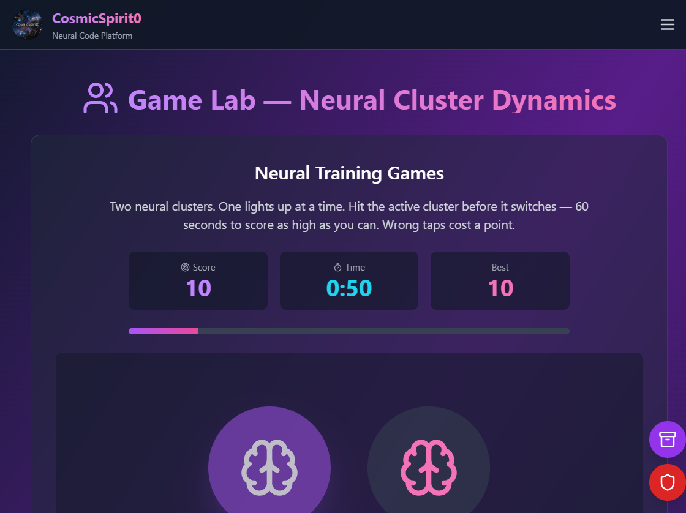

# CosmicSpirit0 — Neural Code Platform

Free, browser-based tools for brainwave entrainment, 3D spatial audio and attention training.
No install, no paywall. Accounts are optional and only unlock the community layer.

**Live:** https://neural-code-platform.vercel.app/

## Labs

| Lab | What it does |
|---|---|
| **Rate Lab** | Binaural beats, isochronic tones and monaural tones from 1 Hz to 40 Hz, with a live oscilloscope |
| **Place Lab** | 3D spatial audio using HRTF processing, an interactive brain model and cochlear mapping |
| **Game Lab** | 60-second attention training — hit the active neural cluster, build a streak, beat your best |
| **Frequency Lab** | Multi-method entrainment, custom presets, layered background noise, session timer |
| **Community** | People logins, shared presets with reviews, small-group Circles, session history and streaks, share cards |
| **Feedback** | Star reviews (moderated) and a public suggestions board |
| **Connect** | Community stories, Instagram, Telegram, YouTube and TikTok |
| **About** | Vision, mission, goals, principles and roadmap |
| **Research & evidence** | Monroe / Hemi-Sync, Silva Method, the 1983 Army “Gateway Process” document, with sources |
| **Transparency** | Live counts, safety, privacy, moderation and funding |
| **Sponsor** | Support tiers, sponsor packages, lead form and a printable one-page deck |

## Tech

- React 18 + TypeScript + Vite
- Tailwind CSS + Framer Motion
- three.js / @react-three/fiber (Place Lab, lazy-loaded)
- d3 (oscilloscope)
- Supabase (Postgres + Row Level Security + Auth) for the newsletter, community, stories, reviews and suggestions
- Web Audio API — all audio is generated in the browser, nothing is uploaded

## Backend

Supabase project `cosmicspirit0` (`jdwiggwqsyeopcgrovjm`), tables:

| Table | Public can | Admin can |
|---|---|---|
| `subscribers` | insert (legacy fallback) | read / delete / export |
| `newsletter_sends` | nothing | read the send log |
| `stories` | insert + read `published = true` | publish, unpublish, delete |
| `reviews` | insert + read `approved = true` | approve, hide, delete |
| `suggestions` | insert + read all | change status, delete |
| `site_settings` | read the single row | update logo + social links |
| `sponsor_leads` | insert (sponsor form) | read / status / delete / CSV export |
| `profiles` | read public profile fields | read / update all |
| `presets` | read `is_public = true` | full access |
| `preset_reviews` | read all + insert/update own | full access |
| `preset_likes` | read all + manage own | full access |
| `sessions` | nothing (owner only) | owner can read/delete own; admin can read |
| `circles` | read public or joined | owner manages |
| `circle_members` | members can read | owner manages |
| `circle_messages` | members can read/write | admin can delete |

Row Level Security allows anonymous inserts only; reads are limited to approved/published rows.
Admin policies match the owner's email in the JWT, so a normal signup can never read submissions.
`site_stats()` is a read-only SQL function used by the Transparency page to publish real counts.
The social schema lives in `supabase/migrations/20261021_social_layer.sql`.

Admin console: **/admin.html** (email + password, same as the Supabase Auth user). The
**Site settings** tab edits the logo and the Instagram, Telegram, YouTube, TikTok and support URLs
without touching code. The **Sponsor leads** tab holds private enquiries with a status
(new / contacted / won / closed) and CSV export.

Sponsor enquiries are never published or added to the newsletter. Support buttons use preset
`paypal.me` amounts and are labelled one-time; recurring invoices are arranged manually until a
payment provider is connected.

## Community (people, presets, circles)

Accounts are email + password through Supabase Auth. Signup is enabled with auto-confirm, so a
listener can start immediately; the account email is never added to the newsletter automatically.
A database trigger creates a profile with a unique handle, and the Profile tab lets the person
change their display name, handle and bio.

- **Shared presets** — Rate, Place and Frequency Labs have **Save as preset**. Public presets can
  be filtered by lab, sorted by newest / rating / plays, liked, reviewed (one review per person,
  1–5 stars) and loaded back into the lab with **Use in lab**. Four official starter presets are
  published by the project account and marked “Starter preset”; they are real configurations, and
  their play/rating counts start at zero like every other preset.
- **Circles** — small public or private groups. Owners get an invite code and link
  (`?circle=CODE`), members get a chronological chat, and any message can carry one of the
  sender's presets as an attachment. Messages are visible only to members. Owners can delete a
  circle (removing its chat and memberships); other members can leave.
- **Sessions and streaks** — playback of 10+ seconds records a private session, updates total
  minutes and advances the daily streak. Only the owner can read their history.
- **Share cards** — a 1080×1350 PNG generated in the browser with only the visible session or
  profile facts; Web Share API where supported, download otherwise.

The social design is a deliberate, limited translation of WhatsApp's useful primitives
(identity, invite links, threads, unread state, exit controls) without claiming end-to-end
encryption or copying a follower graph. The teardown and the omissions are documented in
[`docs/whatsapp-feature-map.md`](docs/whatsapp-feature-map.md).

## Newsletter (double opt-in)

The newsletter is driven by three Vercel Functions in `api/` and two server keys:

1. `POST /api/subscribe` — validates the address, stores it as `pending`, and emails a
   confirmation link. A repeat signup is throttled to one email a minute.
2. `POST /api/confirm` — the visitor clicks **Confirm subscription** on the site; only then does
   the row become `confirmed`. A bare GET never confirms, so inbox link scanners cannot opt
   people in by accident.
3. `POST /api/newsletter` — admin-only (verified Supabase JWT + owner email). Sends plain text as
   branded HTML, adds a per-recipient unsubscribe link, logs the result in `newsletter_sends`, and
   refuses to send above the daily provider cap.

Email delivery supports two providers, and uses both at once:

- **Brevo (primary)** — set `BREVO_API_KEY` plus `BREVO_SENDER_EMAIL`. Best deliverability; the free
  plan is 300 emails/day. When a send fails, the code automatically retries through the relay.
- **Google Apps Script relay (fallback)** — set `EMAIL_WEBHOOK_URL` and `EMAIL_WEBHOOK_SECRET`.
  Free, sends as the project Gmail account, about 100 emails/day. The relay code lives in the Apps
  Script project and rejects any request without the shared secret. See `.env.example` for the
  full list.

The admin **Newsletter** tab shows confirmed / pending / unsubscribed counts, the active provider
(“Brevo (primary) + Gmail relay (fallback)”), the per-send cap, a test send, and the recent send
log. Only confirmed addresses are ever mailed. Every email includes a one-click unsubscribe link
and the postal address in `POSTAL_ADDRESS`.

## Deploy

- **Production:** https://neural-code-platform.vercel.app/ — every push to `main` runs
  `.github/workflows/vercel.yml` (prebuilt Vercel deploy).
- There is deliberately no GitHub Pages mirror. The project is published on Vercel only so a
  shared link does not expose the maintainer’s GitHub profile. See “Why Vercel, not GitHub Pages”
  below.

Vercel builds from the repository root, so the base path is `/`. `vite.config.ts` detects `VERCEL`
automatically. Set `GITHUB_PAGES=false` to force a root-domain build locally if you reuse the
config for a static export.

### Why Vercel, not GitHub Pages

The site is free to host on Vercel. A GitHub Pages URL contains the account name
(`<account>.github.io/...`), which would make the maintainer’s GitHub profile easy to find from any
shared link. Publishing only on Vercel keeps the public URL focused on the project.

## Safety

This is not a medical device. Use headphones at a comfortable volume. Do not use while driving.
If you have epilepsy, a pacemaker, or are pregnant, consult a doctor first. Stop if you feel
discomfort.

## License

MIT
